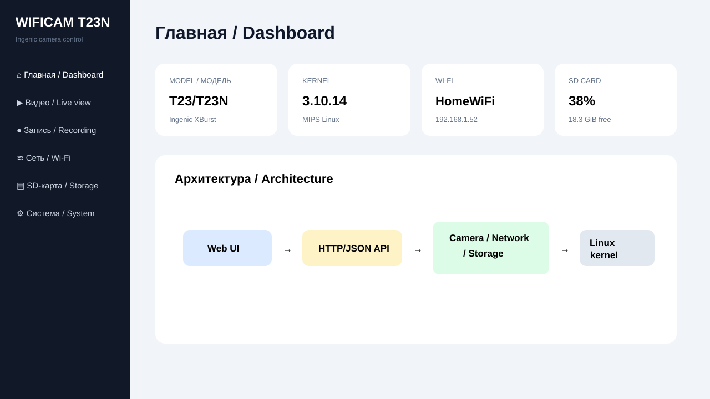
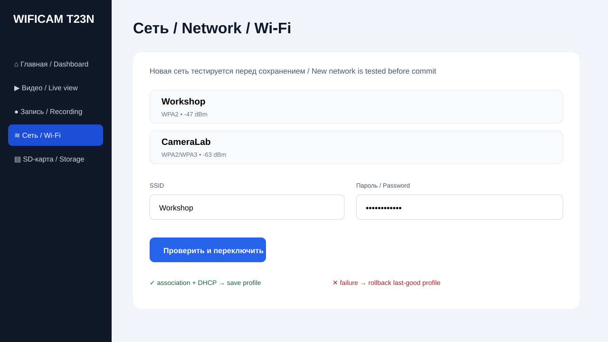
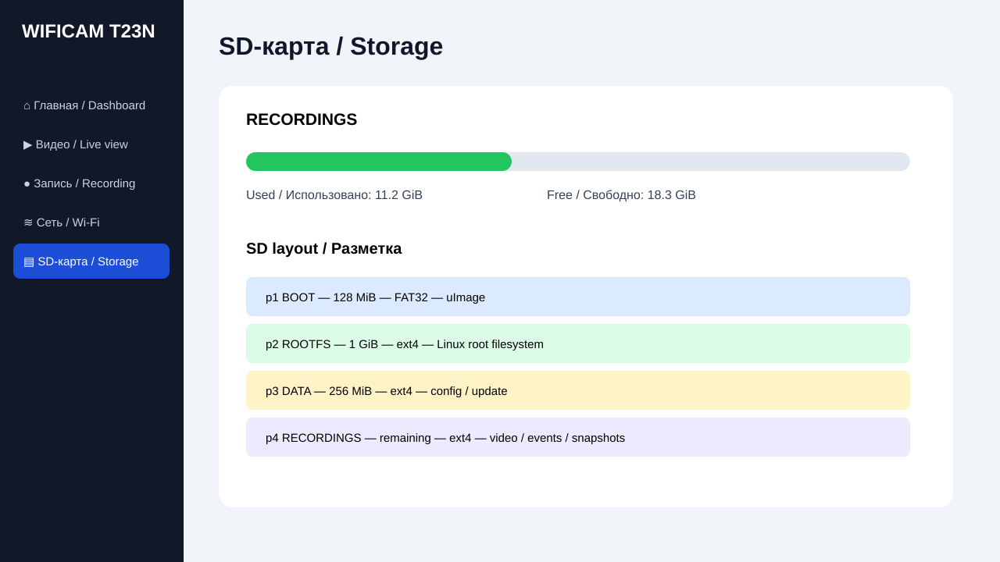
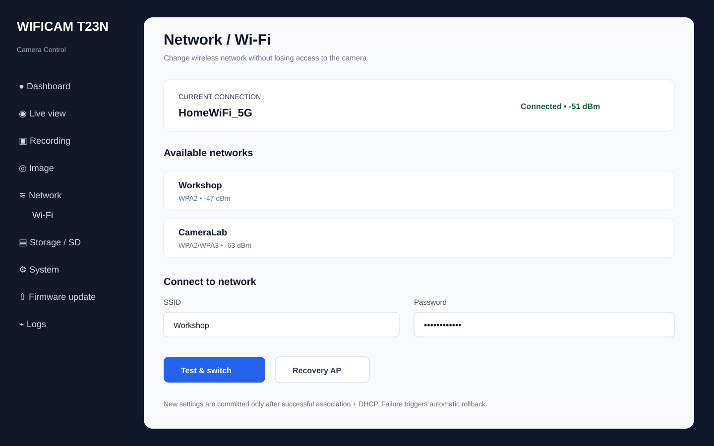

# wificam_T23N

Экспериментальная прошивка и web-панель для Wi‑Fi камеры на **Ingenic T23/T23N**.  
Experimental firmware and web control panel for an **Ingenic T23/T23N** Wi‑Fi camera.

> **Статус / Status:** Linux 3.10.14 kernel build = **SUCCESS**. Web/rootfs overlay, SD preparation tools and the first embedded Web UI/API skeleton are now in the repository. Hardware boot validation through UART/U‑Boot is still required.

## Быстрый старт / Quick start

### 1. Собрать ядро и web/rootfs overlay

```sh
sh scripts/build_all.sh
```

Результат / Output:

```text
~/myipcam/build/kernel/arch/mips/boot/uImage
out/wificam-rootfs-overlay.tar.gz
```

### 2. Сохранить успешную сборку / Save known-good kernel artifacts

```sh
sh scripts/export_known_good.sh
```

Сохраняются `uImage`, `uImage.lzma`, `vmlinux`, `System.map`, `.config` и `SHA256SUMS`.

### 3. Собрать полный rootfs / Assemble a complete rootfs

Overlay сам по себе **не является полноценным rootfs**. Нужен базовый Linux/BusyBox userspace:

```sh
BASE_ROOTFS=/path/to/base-rootfs.tar.gz sh scripts/build_all.sh
```

или / or:

```sh
sh scripts/assemble_rootfs.sh /path/to/base-rootfs.tar.gz
```

Результат:

```text
out/wificam-rootfs.tar.gz
```

### 4. Подготовить SD-карту / Prepare SD card

⚠️ Команда уничтожает все данные на выбранном устройстве.

```sh
sudo sh scripts/prepare_sd.sh \
  /dev/sdX --yes \
  ~/myipcam/build/kernel/arch/mips/boot/uImage \
  out/wificam-rootfs.tar.gz
```

Разметка / Layout:

| Partition | Size | FS | Purpose |
|---|---:|---|---|
| p1 BOOT | 128 MiB | FAT32 | uImage / boot files |
| p2 ROOTFS | 1 GiB | ext4 | complete Linux rootfs |
| p3 DATA | 256 MiB | ext4 | Wi‑Fi/auth/config/update |
| p4 RECORDINGS | rest | ext4 | video/events/snapshots |

**Не стирать штатную SPI/NOR/NAND flash до успешной обратимой загрузки с SD/RAM.**  
**Do not erase the factory SPI/NOR/NAND before a successful reversible SD/RAM boot test.**

## Web UI

Фактический embedded UI находится в `web/` и работает через BusyBox `httpd` + CGI.

```text
Browser
   |
   v
HTML / CSS / JavaScript
   |
   v
BusyBox httpd + CGI JSON API
   |
   +--> Network / wpa_supplicant / udhcpc
   +--> Camera abstraction / ISP / encoder
   +--> Storage / SD recordings
   +--> System controls
   |
   v
Linux 3.10.14 / Ingenic T23/T23N
```

Меню / Menu:

```text
Dashboard / Главная
Live view / Видео
Recording / Запись
Image / Изображение
Network / Wi‑Fi
Storage / SD
System
Firmware update
Logs
```

### Web-пароль / Web password

По умолчанию web-сервер не стартует без пароля:

```sh
printf '%s' 'NEW_PASSWORD_HERE' | wificam-set-web-password admin
/etc/init.d/S90wificam start
```

После этого браузер запросит Basic Authentication. В разделе **System** пароль можно менять из Web UI.

Текущий BusyBox Basic Auth/MD5-crypt — это bootstrap-защита для локальной сети камеры, а не современная Internet-facing authentication scheme. Для внешнего доступа нужны TLS и более современный auth/session backend.

### Wi‑Fi switching

```text
scan SSID
   ↓
enter password
   ↓
create new wpa_supplicant profile
   ↓
associate + DHCP
   ↓
IPv4 received?
  ├─ yes → keep new profile
  └─ no  → restore last-good profile
```

Пароль Wi‑Fi обрабатывается через `wpa_passphrase`; plaintext-комментарий удаляется перед сохранением. Mutating API calls use POST + a per-boot CSRF token.

## Screenshots / Скриншоты

### Dashboard



### Wi‑Fi



### Storage / SD



Дополнительный общий макет / Additional full UI mockup:



## Структура проекта / Project structure

```text
.
├── scripts/
│   ├── build_kernel.sh
│   ├── build_all.sh
│   ├── export_known_good.sh
│   ├── package_rootfs_overlay.sh
│   ├── assemble_rootfs.sh
│   └── prepare_sd.sh
├── rootfs/
│   ├── etc/init.d/S90wificam
│   ├── etc/wificam/wificam.conf
│   └── usr/bin/
│       ├── wificam-camera-ctl
│       └── wificam-set-web-password
├── web/
│   ├── index.html
│   ├── styles.css
│   ├── app.js
│   └── cgi-bin/api
└── docs/
    ├── BUILD_RU.md / BUILD_EN.md
    ├── HARDWARE_AND_SD_RU.md / HARDWARE_AND_SD_EN.md
    ├── WIFI_ARCHITECTURE_RU.md / WIFI_ARCHITECTURE_EN.md
    ├── WEB_STACK_RU.md / WEB_STACK_EN.md
    └── screenshots/
```

## Документация / Documentation

**Русский**
- [Сборка ядра](docs/BUILD_RU.md)
- [Плата, SPI-flash и SD](docs/HARDWARE_AND_SD_RU.md)
- [Wi‑Fi архитектура](docs/WIFI_ARCHITECTURE_RU.md)
- [Web UI/API/rootfs](docs/WEB_STACK_RU.md)

**English**
- [Kernel build](docs/BUILD_EN.md)
- [Board, SPI flash and SD](docs/HARDWARE_AND_SD_EN.md)
- [Wi‑Fi architecture](docs/WIFI_ARCHITECTURE_EN.md)
- [Web UI/API/rootfs](docs/WEB_STACK_EN.md)

## Known-good kernel build

```text
Image:        uImage.lzma
Linux:        3.10.14
Architecture: MIPS
Compression:  LZMA
Load Address: 0x80010000
Entry Point:  0x803c7960
Size:         1739320 bytes
SHA-256:      7ba1c4b0a3ea28d3a7a89cd14330fe1968a0ac63166b08c2d9e715541432565f
```

This proves the kernel build succeeds; it does **not** yet prove compatibility with every T23/T23N board revision. Before permanent flashing validate UART boot logs, U‑Boot environment, RAM, flash, sensor, Wi‑Fi chipset and GPIO.
