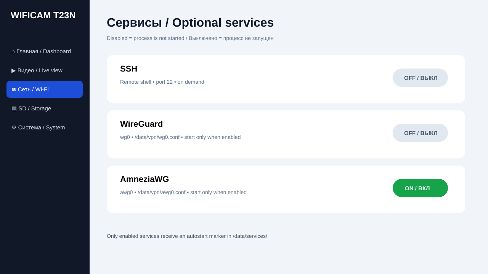

# wificam_T23N


Экспериментальная прошивка и Web UI для Wi‑Fi камеры на **Ingenic T23/T23N**.  
Experimental firmware and Web UI for an **Ingenic T23/T23N** Wi‑Fi camera.

> **Experimental branch:** `mymarrchWFcam` — PegineLab branding + non-blocking boot splash + original ~7 s 8-bit boot jingle.
>
> **Status:** Linux 3.10.14 kernel build = **SUCCESS**. SD/rootfs tooling, Wi‑Fi/IP UI, camera-service integration and on-demand SSH/VPN controls are in the repository.

## PegineLab boot branding / Загрузка

В этой ветке:

- логотип PegineLab встроен в Web UI;
- favicon использует PegineLab PL;
- `S05peginelab-boot` пытается показать логотип через framebuffer;
- оригинальный ~7-секундный 8-bit/chiptune джингл генерируется при сборке;
- splash и звук работают **в фоне** и не должны задерживать Wi‑Fi/camera startup;
- если framebuffer/audio player отсутствуют, загрузка просто продолжается.

Настройки:

```text
BOOT_SPLASH=1
BOOT_SOUND=1
BOOT_BRANDING_SECONDS=7
```

Джингл не хранится большим бинарником в Git. Он воспроизводимо генерируется:

```sh
python3 tools/generate_boot_jingle.py
```

и получается:

```text
web/assets/boot-jingle.wav
```

Файл лёгкий: mono PCM, 8-bit, 11025 Hz, около 77 KiB. Мелодия оригинальная — только стилистика старой 8-bit приставки.

Документация: [RU](docs/BRANDING_BOOT_RU.md) / [EN](docs/BRANDING_BOOT_EN.md).

## Принципы / Design rules

- камера и сенсор инициализируются ОС при загрузке; Web UI не занимается ручным определением сенсора;
- 20 GiB SD выделяется только под фото/видео/события;
- всё остальное место карты получает ROOTFS для Linux, приложений, VPN, SSH и логов;
- SSH, WireGuard и AmneziaWG выключены по умолчанию;
- выключенный optional service не запускает постоянный userspace process;
- Wi‑Fi меняется через test + DHCP + rollback;
- текущие SSID, IPv4, gateway и DNS видны в Web UI;
- штатную SPI/NOR/NAND не стирать до успешной обратимой SD/RAM загрузки.

## Build

```sh
sh scripts/build_all.sh
```

`package_rootfs_overlay.sh` сам генерирует boot jingle, если установлен `python3`, и декодирует компактный PegineLab logo PNG для framebuffer.

Known-good kernel artifacts:

```sh
sh scripts/export_known_good.sh
```

Для полного rootfs нужен базовый BusyBox/Linux userspace:

```sh
BASE_ROOTFS=/path/to/base-rootfs.tar.gz sh scripts/build_all.sh
```

## SD-карта / SD card

Форматирование уничтожает данные на выбранной карте.

```sh
sudo sh scripts/prepare_sd.sh \
  /dev/sdX --yes \
  ~/myipcam/build/kernel/arch/mips/boot/uImage \
  out/wificam-rootfs.tar.gz
```

Разметка вычисляется автоматически:

| Partition | Size | FS | Purpose |
|---|---:|---|---|
| p1 BOOT | 128 MiB | FAT32 | uImage + PegineLab logo/jingle |
| p2 ROOTFS | all remaining space | ext4 | Linux, apps, configs, VPN, SSH, logs |
| p3 MEDIA | 20 GiB | ext4 | recordings, snapshots, events |

MEDIA:

```text
/mnt/media/
├── recordings/
├── snapshots/
└── events/
```

Размер MEDIA можно переопределить, но по умолчанию он фиксирован на 20 GiB:

```sh
MEDIA_GIB=20 sudo -E sh scripts/prepare_sd.sh ...
```

## Web UI

```text
Browser
   |
   v
PegineLab HTML / CSS / JavaScript
   |
   v
BusyBox httpd + CGI JSON API
   |
   +--> Wi-Fi / IP / DHCP
   +--> Camera service managed by OS
   +--> MEDIA storage
   +--> SSH on demand
   +--> WireGuard wg0 on demand
   +--> AmneziaWG awg0 on demand
   |
   v
Linux 3.10.14 / Ingenic T23/T23N
```

Меню:

```text
Dashboard / Главная
Live view / Видео
Recording / Запись
Image / Изображение
Network / Wi‑Fi / IP
  └─ SSH
  └─ WireGuard
  └─ AmneziaWG
Storage / SD
System
Firmware update
Logs
```

### Optional services

Управляет:

```text
wificam-service-ctl
```

Autostart включается только marker-файлом:

```text
/data/services/ssh.enabled
/data/services/wireguard.enabled
/data/services/amneziawg.enabled
```

VPN configs:

```text
/data/vpn/wg0.conf
/data/vpn/awg0.conf
```

Если marker отсутствует, `S91wificam-services` не запускает соответствующий сервис после reboot.

## Wi‑Fi / IP

```text
scan SSID
   ↓
enter password
   ↓
new wpa_supplicant profile
   ↓
association + DHCP
   ↓
IPv4?
  ├─ yes → keep
  └─ no  → restore last-good
```

Web UI показывает SSID, IPv4/CIDR, default gateway и DNS.

## Web password

По умолчанию Web UI не стартует без пароля:

```sh
printf '%s' 'NEW_PASSWORD_HERE' | wificam-set-web-password admin
/etc/init.d/S90wificam start
```

## Screenshots / Скриншоты

### Dashboard


### Wi‑Fi


### Optional services


### Storage


## Structure

```text
.
├── branding/
│   └── peginelab-logo.png.b64
├── tools/
│   └── generate_boot_jingle.py
├── scripts/
│   ├── build_kernel.sh
│   ├── build_all.sh
│   ├── export_known_good.sh
│   ├── package_rootfs_overlay.sh
│   ├── assemble_rootfs.sh
│   └── prepare_sd.sh
├── rootfs/
│   ├── etc/init.d/
│   │   ├── S05peginelab-boot
│   │   ├── S90wificam
│   │   └── S91wificam-services
│   ├── etc/wificam/wificam.conf
│   └── usr/bin/
│       ├── wificam-camera-ctl
│       ├── wificam-service-ctl
│       └── wificam-set-web-password
├── web/
│   ├── assets/peginelab-logo.svg
│   ├── index.html
│   ├── styles.css
│   ├── app.js
│   └── cgi-bin/api
└── docs/
    ├── BRANDING_BOOT_RU.md / BRANDING_BOOT_EN.md
    ├── BUILD_RU.md / BUILD_EN.md
    ├── HARDWARE_AND_SD_RU.md / HARDWARE_AND_SD_EN.md
    ├── WIFI_ARCHITECTURE_RU.md / WIFI_ARCHITECTURE_EN.md
    ├── WEB_STACK_RU.md / WEB_STACK_EN.md
    └── STORAGE_SERVICES_RU.md / STORAGE_SERVICES_EN.md
```

## Documentation

**Русский**
- [Загрузка и PegineLab branding](docs/BRANDING_BOOT_RU.md)
- [Сборка ядра](docs/BUILD_RU.md)
- [Плата и SD](docs/HARDWARE_AND_SD_RU.md)
- [Wi‑Fi/IP/VPN](docs/WIFI_ARCHITECTURE_RU.md)
- [Web UI/API](docs/WEB_STACK_RU.md)
- [Storage и optional services](docs/STORAGE_SERVICES_RU.md)

**English**
- [Boot and PegineLab branding](docs/BRANDING_BOOT_EN.md)
- [Kernel build](docs/BUILD_EN.md)
- [Board and SD](docs/HARDWARE_AND_SD_EN.md)
- [Wi‑Fi/IP/VPN](docs/WIFI_ARCHITECTURE_EN.md)
- [Web UI/API](docs/WEB_STACK_EN.md)
- [Storage and optional services](docs/STORAGE_SERVICES_EN.md)

## Known-good kernel build

```text
Image:        uImage.lzma
Linux:        3.10.14
Architecture: MIPS
Compression:  LZMA
Load Address: 0x80010000
Entry Point:  0x803c7960
Size:         1739320 bytes
SHA-256:      7ba1c4b0a3ea28d3a7a89cd14330fe1968a0ac63166b08c2d9e715541432565f
```
