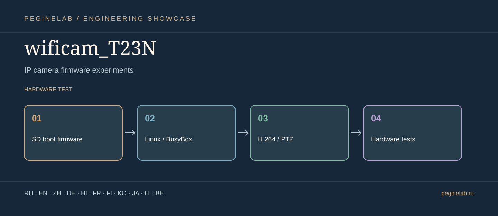

# wificam_T23N · Graphical showcase

**Прошивка и эксперименты IP-камер / IP camera firmware experiments** · SD boot firmware → Linux / BusyBox → H.264 / PTZ → Hardware tests · status: **hardware-test**.

**Hardware warning:** a verified SD boot baseline is not the same as a fully validated firmware release. New builds need physical camera tests.

**Internationalization scope:** these are translated descriptions, not a claim that the application's UI has eleven implemented languages. Features and limitations in the root README take precedence.

### Русский · ru
Экспериментальная загрузка и прошивка камеры Ingenic T23N.. **wificam_T23N** — SD boot firmware → Linux / BusyBox → H.264 / PTZ → Hardware tests.

### English · en
Experimental boot firmware for an Ingenic T23N camera.. **wificam_T23N** — SD boot firmware → Linux / BusyBox → H.264 / PTZ → Hardware tests.

### 简体中文 · zh
Ingenic T23N 摄像头的实验性启动固件。. **wificam_T23N** — SD boot firmware → Linux / BusyBox → H.264 / PTZ → Hardware tests.

### Deutsch · de
Experimentelle Boot-Firmware für eine Ingenic-T23N-Kamera.. **wificam_T23N** — SD boot firmware → Linux / BusyBox → H.264 / PTZ → Hardware tests.

### हिन्दी · hi
Ingenic T23N कैमरे के लिए प्रयोगात्मक बूट फ़र्मवेयर।. **wificam_T23N** — SD boot firmware → Linux / BusyBox → H.264 / PTZ → Hardware tests.

### Français · fr
Firmware de démarrage expérimental pour caméra Ingenic T23N.. **wificam_T23N** — SD boot firmware → Linux / BusyBox → H.264 / PTZ → Hardware tests.

### Suomi · fi
Kokeellinen käynnistysohjelmisto Ingenic T23N -kameralle.. **wificam_T23N** — SD boot firmware → Linux / BusyBox → H.264 / PTZ → Hardware tests.

### 한국어 · ko
Ingenic T23N 카메라용 실험적 부팅 펌웨어.. **wificam_T23N** — SD boot firmware → Linux / BusyBox → H.264 / PTZ → Hardware tests.

### 日本語 · ja
IP カメラファームウェア実験. **wificam_T23N** — SD boot firmware → Linux / BusyBox → H.264 / PTZ → Hardware tests.

### Italiano · it
Esperimenti firmware per telecamere IP. **wificam_T23N** — SD boot firmware → Linux / BusyBox → H.264 / PTZ → Hardware tests.

### Беларуская · be
Эксперыменты з прашыўкай IP-камер. **wificam_T23N** — SD boot firmware → Linux / BusyBox → H.264 / PTZ → Hardware tests.

## Contact / Контакты

[Telegram @Feudorlab1](https://t.me/Feudorlab1) · [Phone +7 926 041 1145](tel:+79260411145)

[feudor.lab@yandex.ru](mailto:feudor.lab@yandex.ru) · [obzorniky@gmail.com](mailto:obzorniky@gmail.com) · [peginelab.ru](https://peginelab.ru/)

[Source repo](https://github.com/musikfed/wificam_T23N)
